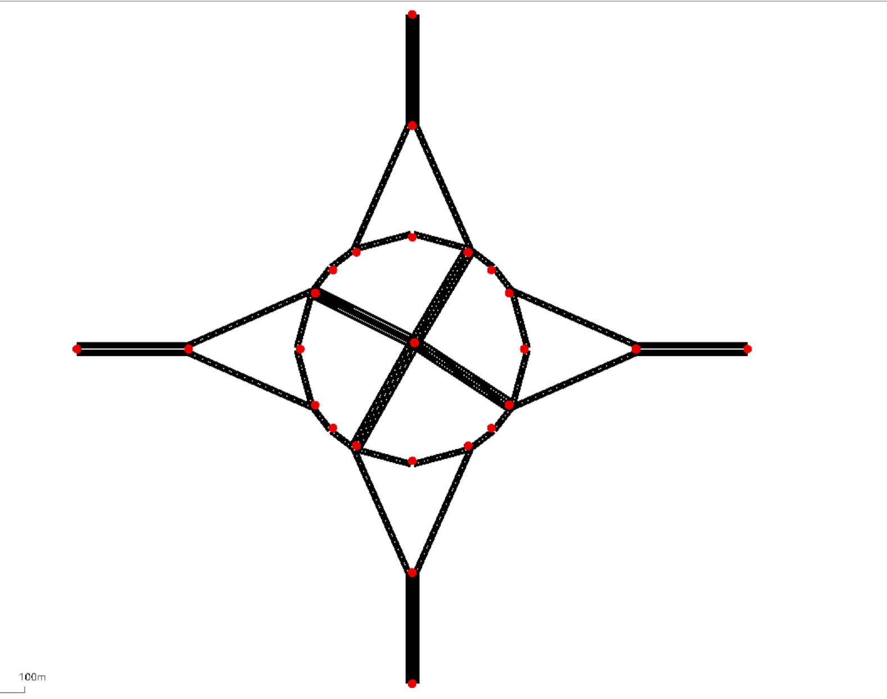
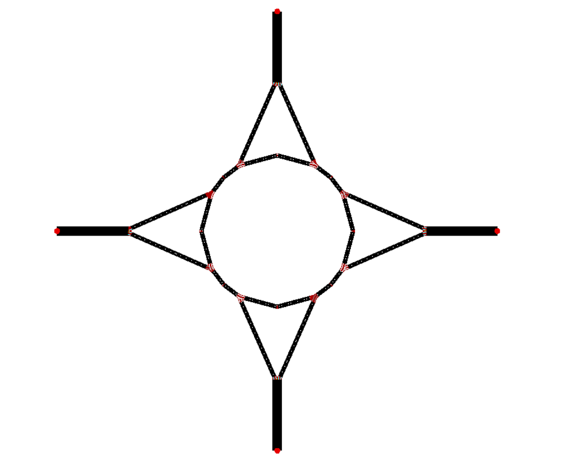
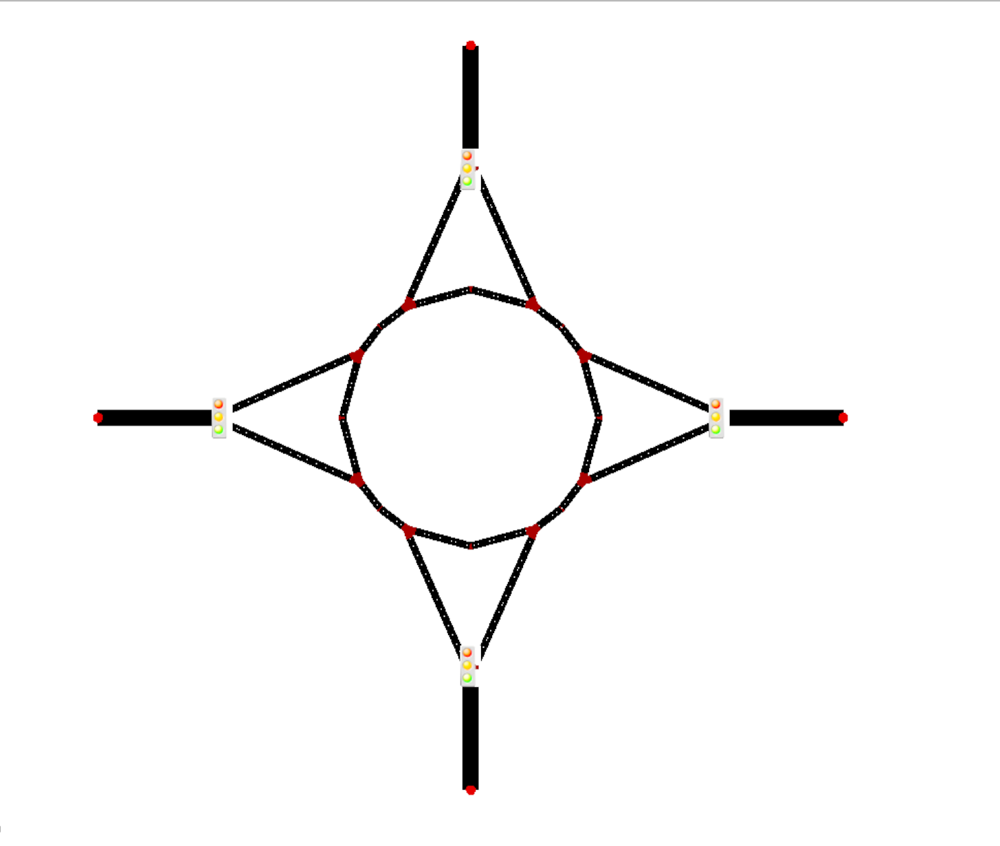

# SUMO-Based Traffic Simulation: An Innovative Two-Lane Roundabout with Central Cross

[](https://eclipse.dev/sumo/)
[](#publication)

A microscopic traffic-simulation study that designs and evaluates an **X-shaped central-cross structure for a two-lane roundabout**. The project compares roundabout and signalized-intersection designs under heavy- and low-traffic demand using **Simulation of Urban MObility (SUMO)**.

The central idea is to divert left-turning vehicles away from the circulating lanes through an X-shaped central cross. This is intended to reduce conflicts and shorten the in-roundabout travel distance for left-turn movements.

## Research Highlights

- Designed a two-lane roundabout with an X-shaped central-cross structure.
- Built and compared six traffic-network configurations, including two signal-timing variants of the central-cross roundabout.
- Evaluated 12 model-scenario combinations under two traffic-demand scenarios.
- Configured vehicle routes and detector-based data collection in SUMO.
- Compared traffic performance using throughput, mean speed, halts, time loss, and total travel time.
- Found that the central-cross roundabout (RCC) achieved the best overall performance in the reported experiments; the tested traffic-light controls did not improve heavy-flow performance.

## 1. Model Design

### X-shaped central-cross roundabout

The proposed model combines a two-lane roundabout with an X-shaped central crossing that connects the four approaches. Under the routing rules described in the paper:

- Left-turning vehicles are diverted through the central cross.
- Straight-through and right-turning vehicles remain on the roundabout.
- Vehicles enter the central cross from the innermost lane and leave the roundabout from the outermost lane.
- Vehicles passing through the central cross are restricted to straight movements.

See the original model diagram and network files in `models/x_cross_roundabout/`.

**Network diagrams from the supplied archive**

| X-shaped central-cross roundabout | Basic two-lane roundabout | Signalized two-lane roundabout |
|---|---|---|
|  |  |  |

### Six models evaluated in the paper

| Paper model | Short name | Description |
|---|---|---|
| Model 1 | RCC | Roundabout with X-shaped central cross |
| Model 2 | RCCS (46 s) | Central-cross roundabout with the longer signal-timing configuration |
| Model 3 | RCCS (26 s) | Central-cross roundabout with the shorter signal-timing configuration |
| Model 4 | RS | Roundabout with traffic lights at junctions |
| Model 5 | BR | Basic two-lane roundabout |
| Model 6 | SI | Signalized intersection |

The repository contains the network, route, detector, and signal-definition files that were supplied in the project archive. The signal logic files are retained as source artifacts. The exact signal-file-to-paper-variant mapping should be checked in SUMO before treating a locally reconstructed run as an exact reproduction of the published experiment.

## 2. Experimental Design

The paper defines two traffic-demand scenarios:

| Scenario | Vehicle arrival rate | Models |
|---|---:|---|
| Heavy traffic | 2.44 vehicles/second | Models 1–6 |
| Low traffic | 0.52 vehicles/second | Models 7–12 |

The same six model types are evaluated in each scenario. Vehicle demand is represented through 16 directional movement flows (four approaches with left, right, straight, and U-turn movements as applicable).

### Detector and data collection setup

- 16 lane-level entry/exit detector locations across the four approaches.
- SUMO E3 detectors collect vehicle passage information.
- The paper specifies a 100 Hz sensor sampling frequency.
- The supplied archive includes detector definition files and detector-output XML files, in addition to the two Excel workbooks containing interval-based metrics.

## 3. Evaluation Metrics

The paper evaluates the traffic models using five main metrics:

| Metric | Meaning | Preferred direction |
|---|---|---|
| Number of passing vehicles | Cumulative number of vehicles that have passed the modeled area | Higher |
| Mean speed | Average speed of passing vehicles | Higher |
| Mean halts per vehicle | Average number of halts per vehicle | Lower |
| Mean time loss per vehicle | Delay relative to ideal travel time | Lower |
| Total time for all vehicles to pass | Aggregate time required for vehicles to pass the area | Lower |

A halt is defined in the paper as vehicle speed below 5 km/h for more than 1 second.

## 4. Main Findings Reported in the Paper

- Under heavy traffic, Model 1 (RCC) achieved the best performance among the evaluated models on the cumulative passing-vehicle comparison and total time for all vehicles to pass.
- The RCC model completed the heavy-traffic scenario in **1,669 seconds** and the low-traffic scenario in **489.55 seconds**, according to the paper's reported total-time comparison.
- The paper concludes that adding traffic-light control at the junction or central cross did not improve the traffic efficiency of the two-lane roundabout under the tested heavy-traffic conditions.
- The basic roundabout with junction signals (RS in the paper's model naming) and the signalized intersection were among the weaker configurations in the reported comparisons.

These are findings from the published paper, not newly reproduced measurements. Consult the paper figures and tables for metric-specific comparisons and experimental caveats.

## 5. Repository Structure

```text
.
├── README.md
├── paper/
│   └── A_Novel_Two-Lane_Roundabout_Model_with_Central_Cross.pdf
├── models/
│   ├── x_cross_roundabout/
│   ├── basic_two_lane_roundabout/
│   ├── signalized_two_lane_roundabout/
│   └── signalized_intersection/
├── results/
│   ├── raw/
│   │   ├── heavy_traffic_metrics_original.xlsx
│   │   ├── low_traffic_metrics_original.xlsx
│   │   └── detector-output XML files
│   └── processed/
│       ├── heavy_traffic_metrics_long.csv
│       ├── low_traffic_metrics_long.csv
│       └── scenario_model_summary.csv
├── assets/
├── scripts/
│   └── process_results.py
└── docs/
    ├── model_inventory.md
    └── data_dictionary.md
```

### SUMO file types

| File suffix | Purpose |
|---|---|
| `.net.xml` | Road network and junction/lane topology |
| `.rou.xml` | Vehicle routes and traffic demand flows |
| `.add.xml` | Additional simulation objects, including E3 detectors |
| `.sumocfg` | SUMO simulation configuration |
| `.tl.xml` / `.trl1.xml` | Traffic-light logic definitions |
| `.xlsx` | Exported interval-based traffic metrics |
| `e3_*.xml` | Detector definitions or recorded detector intervals, depending on file |

## 6. Getting Started

### Install SUMO

Install SUMO and make sure `sumo` and `sumo-gui` are available from the command line. The supplied network/configuration files were generated with older SUMO/NetEdit versions (the file headers mention SUMO 1.4.0 and NetEdit 1.12.0). Newer SUMO releases may require compatibility checks.

Official resources:
- [SUMO documentation](https://sumo.dlr.de/docs/)
- [SUMO downloads](https://sumo.dlr.de/docs/Downloads.php)

### Run a supplied scenario

From the repository root, run one of the curated configuration files:

```bash
# Proposed central-cross roundabout (RCC)
sumo-gui -c models/x_cross_roundabout/rcc_baseline.sumocfg

# Basic two-lane roundabout (BR)
sumo-gui -c models/basic_two_lane_roundabout/basic_roundabout.sumocfg

# Roundabout with signalized junctions (RS)
sumo-gui -c models/signalized_two_lane_roundabout/signalized_roundabout.sumocfg

# Signalized intersection (SI)
sumo-gui -c models/signalized_intersection/signalized_intersection.sumocfg
```

The curated configurations use relative file paths and include the detector definitions. The signalized-roundabout and signalized-intersection configurations also include their supplied traffic-light logic files.

The two central-cross traffic-light XML files (`model_test.tl.xml` and `model_test.tl2.xml`) are preserved in `models/x_cross_roundabout/`. Before using them for an RCCS reproduction, verify their traffic-light IDs and phase definitions against the intended network and the paper's 46-second and 26-second timing descriptions.

### Process the supplied Excel metrics

The original workbooks store six model result blocks side by side. The included processing script reshapes these wide-format workbooks into tidy, long-format CSV files with scenario and model labels.

```bash
python -m pip install pandas openpyxl
python scripts/process_results.py
```

The script writes:
- `results/processed/heavy_traffic_metrics_long.csv`
- `results/processed/low_traffic_metrics_long.csv`
- `results/processed/scenario_model_summary.csv`

The model-block order follows the six-model sequence in the paper: RCC, RCCS (46 s), RCCS (26 s), RS, BR, and SI.

## 7. Data Notes and Reproducibility

- The original Excel files are preserved under `results/raw/`.
- Processed CSVs are derived from the supplied workbooks; they are not new SUMO simulation runs.
- The paper reports 2.44 vehicles/second for heavy traffic and 0.52 vehicles/second for low traffic in its scenario-design section. The scenario-design section is used here as the source of truth for those rates.
- Some archived SUMO configurations and signal files contain historical absolute Windows paths in comments or generation metadata. The curated `.sumocfg` files use relative paths, but the network/route assets should still be checked locally before claiming exact reproduction.
- The archive contains four main model folders and signal-logic variants, while the paper compares six model configurations. The six result blocks are labeled according to the paper's stated model order.
- The detector XML files include both detector definitions and exported interval records; their roles are described in `docs/model_inventory.md`.
- No fresh simulation was run as part of this repository documentation update.

## 8. Publication

**Ke Xu, Longfei Zhou, Fan He, Siyu Wu, Haoliang Liu, Fei Teng, Zehang Li, Yuliang Gai, Pengfei Liu, and Yifan Mo.**  
“A Novel Two-Lane Roundabout Model with Central Cross Structure.”  
IEEE 6th International Conference on Universal Village (UV2022), Session 7052.

The paper is included in `paper/`. Please cite the publication when reusing the model design or experimental findings.

## 9. Future Work

1. Verify and standardize all six SUMO model configurations, including both RCCS signal-timing variants.
2. Re-run all models with a documented SUMO version and fixed random seeds.
3. Automate detector-output parsing and compute all five evaluation metrics from raw simulation output.
4. Run repeated trials and report mean, standard deviation, and confidence intervals.
5. Extend the traffic scenarios with turning-ratio variation, demand imbalance, and additional congestion levels.
6. Compare fixed-time signal control with adaptive traffic-signal control.
